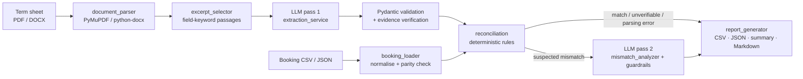

# LLM-Powered Term Sheet Reconciliation

Automated reconciliation of bond **term sheets** (PDF / Word) against **booking-system extracts** (CSV / JSON), using the [Groq Cloud](https://console.groq.com/docs/overview) LLM API for field extraction and for a second-pass "true mismatch vs. false alert" review. Every extracted value carries a verbatim quote from the source document, which is verified by code before the value is used.

```
python main.py
...
  Match              136      Parsing Error        0
  False Alert          0      Unverifiable        39
  True Mismatch       15      Unresolved           0
  Failed LLM calls     0      Field comparisons  190
```

---

## Contents

1. [Business problem](#business-problem)
2. [Quick start](#quick-start)
3. [How it works](#how-it-works)
4. [Inputs and outputs](#inputs-and-outputs)
5. [Results on the supplied data](#results-on-the-supplied-data)
6. [Configuration](#configuration)
7. [Testing](#testing)
8. [Troubleshooting](#troubleshooting)
9. [Assumptions and limitations](#assumptions-and-limitations)
10. [Project structure](#project-structure)

---

## Business problem

Operations teams check that every booked trade matches the legal terms of the instrument: coupon, maturity, dates, conventions, denominations. Term sheets are unstructured, long (13–16 pages here) and inconsistent in layout, so checking them by hand is slow and error-prone. This tool:

* reads each term sheet and extracts 19 financial fields **with source evidence and page numbers**;
* validates every value against a strict schema (a malformed value becomes a **Parsing Error**, never a mismatch);
* compares the terms with every booked trade, field by field, using deterministic rules;
* sends each suspected break to a **second LLM pass** that classifies it as a **True Mismatch** or a **False Alert**, under guardrails;
* writes CSV / JSON / Markdown reports that a business reviewer can act on.

## Quick start

**Prerequisites:** Python 3.11+ and a free Groq API key from <https://console.groq.com/keys>.

```bash
git clone <this-repo> term-sheet-reconciliation
cd term-sheet-reconciliation

python -m venv .venv
# Windows: .venv\Scripts\activate      macOS/Linux: source .venv/bin/activate
pip install -r requirements.txt

cp .env.example .env          # Windows: copy .env.example .env
# edit .env and set GROQ_API_KEY=gsk_...

python test_groq_connection.py    # 1 live request: checks the key and model
python main.py                    # full reconciliation of both term sheets and all 10 trades
```

The full run takes about 2.5 minutes. Most of that is waiting for Groq's free-tier window of 8,000 tokens per minute; the tool paces itself instead of failing. Reports are written to `outputs/`.

### API key configuration

| Variable | Required | Default | Purpose |
|---|---|---|---|
| `GROQ_API_KEY` | yes | – | Groq Cloud key (kept in `.env`, which is git-ignored) |
| `GROQ_MODEL` | no | `openai/gpt-oss-20b` | Any chat model available to your key (`test_groq_connection.py` lists them) |
| `GROQ_TIMEOUT` | no | `60` | Seconds per HTTP request |
| `GROQ_MAX_RETRIES` | no | `3` | Retries for rate limits, timeouts, network and 5xx errors |

The key is read only from the environment / `.env`. It is never logged: log records pass through a redaction filter, and the settings object hides the key in `repr`. Variables already set in the process environment (CI secrets, containers) take precedence over `.env`.

### Command-line options

```bash
python main.py                                  # all jobs in data/manifest.json; CSV+JSON with parity check
python main.py --booking-format csv             # reconcile from the CSV extracts only (or: json)
python main.py --no-cache                       # force fresh LLM calls
python main.py --model openai/gpt-oss-120b      # try another Groq model for this run
python main.py --term-sheet path/to/ts.docx --booking-json path/to/trades.json   # ad-hoc job
python main.py --date-order DMY                 # day/month order for numeric booking dates (default: inferred)
```

Exit codes: `0` success (breaks found is still a success), `1` one or more jobs failed, `2` configuration error, `3` fatal LLM error (bad key / unavailable model).

## How it works



**1. Parsing.** PyMuPDF extracts each page in two views. The *layout* view keeps table labels and values on one line ("16. Coupon Rate 10.75% p.a.") and is what the LLM reads. The *reading-order* view keeps multi-line table cells intact. Word files are read with python-docx: paragraphs and table rows in body order, with explicit page breaks starting new pages. Scanned, encrypted, corrupt and legacy `.doc` files fail with clear messages.

**2. Excerpt selection.** The term sheets are 30–42K characters, larger than the free tier's 8K tokens per minute. Blocks of text are scored against per-field patterns ("Coupon Rate", "Tenor", "Face Value", "Deemed Date of Allotment", ...), and the best ones are packed into a 12,000-character budget in document order with `[Page N]` markers. Small documents are sent whole. The pages sent and a per-field "candidate passage found" flag are saved with each extraction. If a passage is missed, the field comes back null and is reported as *Unverifiable*; the tool never makes up a value.

**3. LLM pass 1: extraction** (`openai/gpt-oss-20b`, JSON mode, temperature 0). The system prompt defines the 19 fields, their formats and their business meaning: issue size is not a trade notional, a call date is not a maturity, and so on. It also requires **verbatim** quotes and a `stated` / `derived` basis, with an explanation for derived values. Document text is enclosed in delimiters and marked as untrusted data.

**4. Validation (code, not the LLM).** Each field is validated independently, so one bad field never discards the others:

* **Strict Pydantic types:** ISO dates; numbers that must be JSON numbers (`"10.75%"` fails); ISIN format plus check digit; ISO 4217 currency; enumerations for frequency, day count and amortisation; `"PERPETUAL"` as a valid maturity.
* **Evidence verification:** every quote must exist in the document after a fixed normalisation: Unicode/quote/dash folding and collapsed whitespace, with a whitespace-insensitive fallback for words hyphenated across lines. The page is taken from where the quote was *found*, not from the page the model claimed.
* **Grounding:** a value marked "stated" must literally appear in its own quote. Crore/lakh/million scaling and Indian digit grouping (`Rs.10,00,000`) are understood.
* **Field semantics:** a trade notional that reuses an issue-level amount (issue size, denomination, minimum subscription) is rejected.

Failures become **Parsing Errors**. Malformed JSON gets one corrective retry. Fields that fail validation get one targeted repair call, and a repaired value is accepted only if it passes every check.

**5. Booking ingestion.** CSV and JSON are mapped to canonical column names. Values are normalised to the same types as the term-sheet side, and an unparseable value becomes a booking-side Parsing Error for that field only. Numeric dates such as `4/14/2021` are read using a day/month order inferred for the whole file from unambiguous values; if the file is ambiguous the run stops with an error instead of guessing. With `--booking-format both` (the default), each trade is reconciled once (JSON is primary) and a **CSV/JSON parity report** is produced.

**6. Deterministic reconciliation** (`reconciliation.py`). A registry maps each field kind to a comparator, and new rules plug in with `register_kind` / `register_field`:

| Field kind | Rule |
|---|---|
| Dates | calendar-date equality after parsing any supported format |
| Maturity | perpetual-aware: `PERPETUAL` vs. a fixed date is a hard difference |
| Coupon / price | equality in percent units; `0.1075` vs `10.75%` is a *candidate* representation difference, not a match |
| Amounts | exact decimal equality; differences of ×1,000 / lakh / million / crore are flagged as candidate unit differences |
| Names | case, punctuation and legal-suffix insensitive (`Ltd` = `Limited`) |
| Conventions | synonym vocabularies (`Act/Act` = `Actual/Actual`, `half-yearly` = `Semi-annual`) |
| Locations | order- and case-insensitive set comparison (`Oslo\|New York`) |
| Notional | **never compared with the issue size.** It is checked to be a whole number of bonds at the term-sheet denomination; otherwise *Unverifiable* |

A field the term sheet does not state is **Unverifiable**: it is never treated as a match or a mismatch.

**7. LLM pass 2: mismatch analysis.** Each suspected mismatch is sent with the field definition, the verified quotes, the raw and normalised values, the deterministic finding and related terms. The verdict is validated with Pydantic. Guardrails then apply:

* `INSUFFICIENT_EVIDENCE`, a verdict without supporting evidence, a failed call or an invalid response all become **Unresolved**. The tool never fabricates a decision.
* A **False Alert** for values that still differ *in the same unit* after normalisation is held as Unresolved, unless it is a weekend business-day roll that code can verify. A low-confidence False Alert is also held.
* Identical breaks are adjudicated once and the verdict is reused: the same perpetual-vs-2025 maturity on five trades costs one call.

## Inputs and outputs

### Inputs (`data/`)

| File | Description |
|---|---|
| `term_sheets/IDBI_Omni_Term_Sheet.pdf` | IDBI Bank AT1 perpetual bond, 16-page Indian term sheet (3-column table layout) |
| `term_sheets/Genel_Energy_Term_Sheet.pdf` | Genel Energy Finance 4 Ltd 9.25% 2020/2025 bond, 13-page Nordic term sheet |
| `booking/IDBI_Omni.{csv,json}` | 5 booked trades (ISO dates; pipe-delimited lists in CSV) |
| `booking/Genel_Energy.{csv,json}` | 5 booked trades (CSV uses US `M/D/YYYY` dates) |
| `manifest.json` | Links each term sheet to its booking files. This is needed because the IDBI term sheet contains no ISIN to match on |

### Outputs (`outputs/`)

| File | Content |
|---|---|
| `reconciliation_results.csv` | One row per trade × field (190 rows): values, normalised values, evidence quote and page, initial comparison, final status, LLM verdict and explanation, error details |
| `reconciliation_results.json` | Same rows as typed JSON, plus run metadata |
| `reconciliation_summary.json` | Counts (matches, false alerts, true mismatches, parsing errors, unverifiable, unresolved, failed LLM calls) overall and by document, field and trade; exceptions list; CSV/JSON parity; LLM usage |
| `reconciliation_report.md` | Reviewer report: outcome, trade status, exceptions with explanations, false alerts, unverifiable fields, extracted terms with evidence |
| `extractions/*.extraction.json` | Audit trail per term sheet: every field with value, raw value, basis, verified quotes, match type, pages sent to the LLM |

**Final statuses.** `Match`, `False Alert` and `True Mismatch` are reconciliation outcomes. `Parsing Error` (validation failed), `Unverifiable` (the term sheet does not state the field) and `Unresolved` (no defensible LLM verdict) are exceptions and are kept visible separately. Each trade is labelled `CLEAN`, `BREAK` (any True Mismatch) or `NEEDS REVIEW` (Parsing Error or Unresolved).

## Results on the supplied data

Live run with `openai/gpt-oss-20b` on 19 Oct 2026: 2 extraction calls and 7 adjudication calls (8 verdicts reused), 0 failures, about 19.7K tokens.

| Term sheet | Trade | Break | Term sheet (page) | Booking | Verdict |
|---|---|---|---|---|---|
| IDBI | 1–5 | Maturity | Perpetual (p. 1) | 2025-10-17 | True Mismatch: a perpetual bond cannot have a fixed maturity |
| IDBI | 1–5 | Business day convention | Following for coupon dates, Preceding otherwise (p. 15) | "Business day adjustment" | True Mismatch: the booking does not capture which convention applies to which date (LLM judgement) |
| IDBI | 2 | Coupon | 10.75% (p. 3) | 11.00 | True Mismatch |
| IDBI | 3 | Notional | denomination Rs.10,00,000 (p. 3) | 1,100,000 | True Mismatch: 1.1 bonds is not a whole number of bonds |
| IDBI | 4 | Issue date | 17 Oct 2014, Deemed Date of Allotment (p. 8) | 2014-10-10 | True Mismatch |
| Genel | 2 | Maturity | 14 Oct 2025 (p. 1) | 2025-10-15 | True Mismatch |
| Genel | 4 | Coupon | 9.25% (p. 1) | 9.50 | True Mismatch |

Genel trades 1, 3 and 5 are **CLEAN**. Genel trade 3's notional of 3,100,000 differs from the other trades, but it is a valid 1,550 bonds of USD 2,000 and the term sheet states no trade notional, so it is reported as *Unverifiable*, not as a break. Fields that are **Unverifiable** because the term sheet does not state them:

* IDBI: ISIN, parent, issue price, business-day centres, settlement date (only a pay-in *window* is given), trade notional.
* Genel: settlement date, trade notional.

Both CSV/JSON extract pairs passed the parity check. Example reports from this run are committed in `outputs/`.

## Configuration

Optional variables (see `.env.example`):

| Variable | Default | Purpose |
|---|---|---|
| `GROQ_REASONING_EFFORT` | `low` | Reasoning effort for gpt-oss models; leave empty for non-reasoning models |
| `GROQ_TEMPERATURE` | `0` | Sampling temperature |
| `EXTRACTION_MAX_CHARS` | `12000` | Document characters per extraction call (keep the prompt under the 8K TPM limit) |
| `EXTRACTION_MAX_TOKENS` / `ADJUDICATION_MAX_TOKENS` | `4000` / `1500` | Completion limits |
| `BOOKING_DATE_ORDER` | `auto` | `auto`, `MDY` or `DMY` for numeric dates in booking files |
| `LOG_LEVEL` | `INFO` | Console log level; a JSON-lines log is always written to `logs/` |

**Caching.** Validated LLM responses are cached in `.cache/`, keyed by SHA-256 of the model, prompt version and full prompt text (which contains the document text). A changed document, prompt or model never reuses an old answer. Cached content is re-validated on every read, and extractions with Parsing Errors are never cached. Use `--no-cache` to force fresh calls.

**Adding a field or source.** Add a `FieldSpec` in `src/field_catalog.py`; the schema, prompt, booking loader and reconciliation pick it up automatically. Add a comparator with `ReconciliationEngine.register_kind`. Add a term sheet by adding an entry to `data/manifest.json`. Another LLM provider only needs to implement `complete_json` from the `LLMClient` protocol in `src/llm_client.py`.

## Testing

```bash
pytest -q                          # 151 offline tests, mocked LLM (about 20 s)
RUN_LIVE_TESTS=1 pytest -m live    # live Groq extraction of both term sheets (about 2 min, uses quota)
# Windows PowerShell: $env:RUN_LIVE_TESTS="1"; pytest -m live
```

The offline suite covers PDF and Word parsing (including generated DOCX, corrupt and image-only files), evidence verification on the real PDFs, CSV/JSON ingestion and parity, date-order inference, Pydantic validation of wrong types, normalisation (dates, percentages, crore/lakh), exact matches, false alerts, true mismatches, missing fields, perpetual maturity, issue amount vs. notional, invalid JSON responses and repair, Groq errors (401 / 404 / 429 / quota / timeout / network / 400 `json_validate_failed`), retry and backoff, throttling, secret redaction, caching, and the complete workflow on both term sheets with mocked LLM responses. The mocked extraction responses quote the real PDFs verbatim, so evidence verification runs for real.

## Troubleshooting

| Symptom | Cause / fix |
|---|---|
| `Configuration error: GROQ_API_KEY is not set` | Create `.env` from `.env.example` and paste your key |
| `AUTHENTICATION ... (HTTP 401)` | Key revoked or mistyped; create a new one at console.groq.com/keys |
| `MODEL_UNAVAILABLE ... (HTTP 404)` | Model retired or not enabled for your key. `python test_groq_connection.py` lists available models; set `GROQ_MODEL` |
| `Waiting NN s for Groq's token window` | Normal on the free tier (8K tokens/min). The tool paces itself |
| `QUOTA_EXCEEDED` | Daily free-tier quota used up; retry later or switch model. Affected rows are reported as Unresolved, not dropped |
| `REQUEST_TOO_LARGE (HTTP 413)` | Lower `EXTRACTION_MAX_CHARS` |
| `NETWORK` / `TIMEOUT` | Check connectivity / proxy to `api.groq.com`, or raise `GROQ_TIMEOUT` |
| `numeric dates are ambiguous` | Set `BOOKING_DATE_ORDER=MDY` or `DMY` (or `--date-order`) |
| `no extractable text (scanned/image-only document?)` | The PDF has no text layer; OCR is out of scope |
| A field shows `Parsing Error` | See `error_details` and `outputs/extractions/*.json`: schema, evidence, grounding or field-semantics failure |
| Results vary slightly between runs | LLM output is not fully deterministic even at temperature 0. Validation, the repair pass and the guardrails keep a deviation from turning into a wrong Match or Mismatch |

## Assumptions and limitations

* **Field semantics.** Booking `InterestPaymentDate` is the *first* coupon date. For IDBI it is derived as the first anniversary of the Deemed Date of Allotment and marked `derived`. IDBI's Deemed Date of Allotment is treated as the issue date; the subscription opening and closing dates are not. Issue amount is the base size (the Rs.1,000 crore green-shoe is noted, not added).
* **Trade notional** cannot be verified from an issue-level term sheet. It is only checked for being a whole number of bonds at the denomination. Being below the primary-market minimum subscription is noted but not treated as a break, because secondary trades can be smaller.
* **Excerpt selection** is keyword-based. A term expressed in unusual wording could be missed; the result is then a conservative *Unverifiable*, never a fabricated value.
* **LLM judgement calls** remain judgement calls. For example, the second pass rated IDBI's generic "Business day adjustment" a True Mismatch against the term sheet's split Following/Preceding convention. The explanation and evidence are in the report so a reviewer can override.
* Evidence-clause choice depends on the model. `gpt-oss-20b` sometimes cites a weaker but correct clause (IDBI day count from the application-money clause, which states the same Actual/Actual). In testing, `gpt-oss-120b` chose clauses better but more often paraphrased quotes, which validation then rejects.
* Not supported: OCR for scanned PDFs, legacy `.doc`, XML booking files, holiday calendars (weekend-only business-day check).

## Project structure

```text
term-sheet-reconciliation/
├── main.py                      CLI entry point
├── test_groq_connection.py      standalone live API check
├── src/
│   ├── config.py                environment-driven settings (.env)
│   ├── logging_setup.py         console + JSON-lines logging with secret redaction
│   ├── field_catalog.py         the 19 fields: kind, scope, business definition
│   ├── schemas.py               Pydantic models (LLM contracts and result records)
│   ├── normalizer.py            dates, decimals, ISIN, vocabularies, text normalisation
│   ├── document_parser.py       PDF (PyMuPDF) and DOCX (python-docx) text extraction
│   ├── excerpt_selector.py      token-budgeted, traceable passage selection
│   ├── evidence.py              verbatim quote verification and page location
│   ├── prompts.py               prompt templates (versioned), injection hygiene
│   ├── llm_client.py            Groq client: typed errors, retries, backoff, throttling
│   ├── cache.py                 content-addressed response cache
│   ├── extraction_service.py    LLM pass 1 + validation + repair
│   ├── booking_loader.py        CSV/JSON ingestion, normalisation, parity check
│   ├── reconciliation.py        deterministic comparison engine (pluggable rules)
│   ├── mismatch_analyzer.py     LLM pass 2 + guardrails
│   ├── report_generator.py      CSV / JSON / summary / Markdown reports
│   └── pipeline.py              orchestration and manifest handling
├── tests/                       pytest suite (offline + opt-in live)
├── data/                        sample term sheets, booking extracts, manifest
├── outputs/                     reports from the latest run
├── Dockerfile, .github/workflows/ci.yml
├── requirements.txt, pyproject.toml, .env.example, .gitignore
└── TECHNICAL_REPORT.md          two-page design report
```

**Docker** (provided, not part of the tested setup):

```bash
docker build -t term-sheet-recon .
docker run --rm --env-file .env -v "$PWD/outputs:/app/outputs" term-sheet-recon
```

**CI:** `.github/workflows/ci.yml` runs the offline test suite on every push and pull request. A manually triggered job can run the live reconciliation using a `GROQ_API_KEY` repository secret and upload the reports as an artifact.
